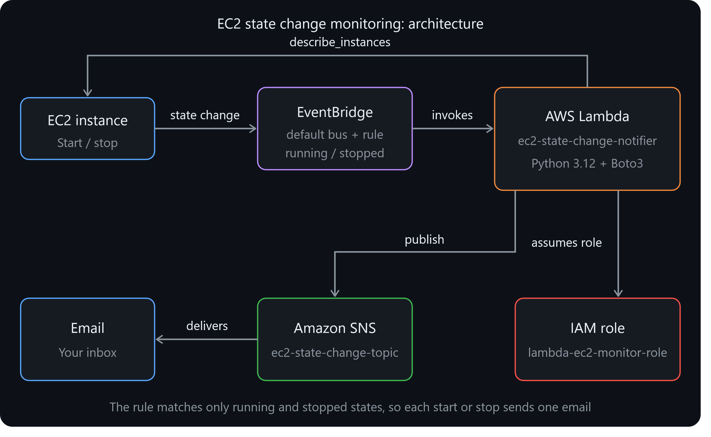
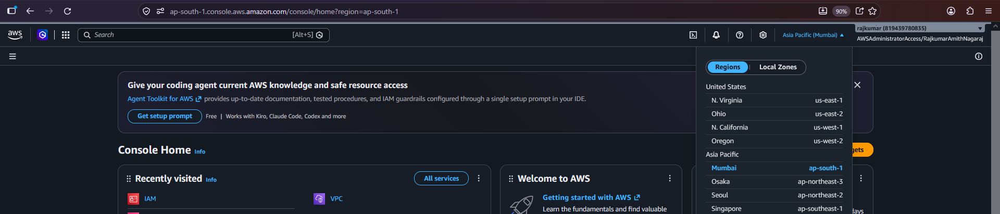
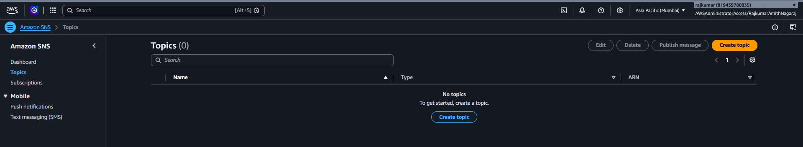
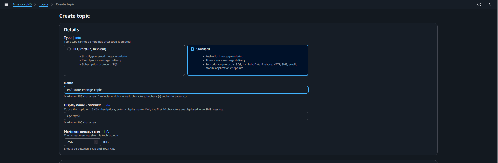
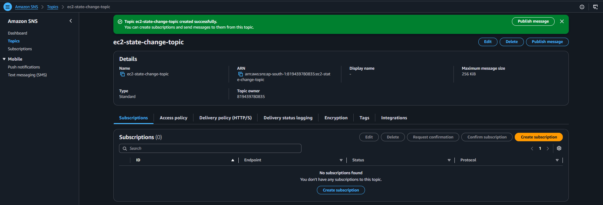
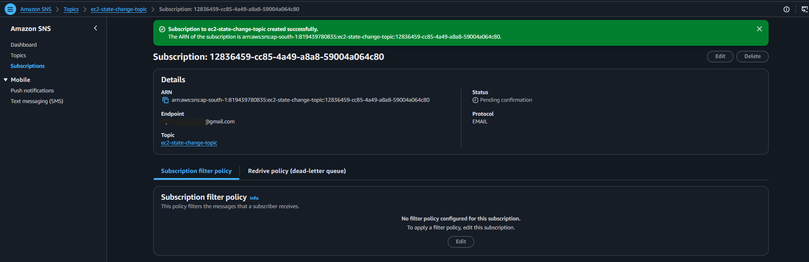
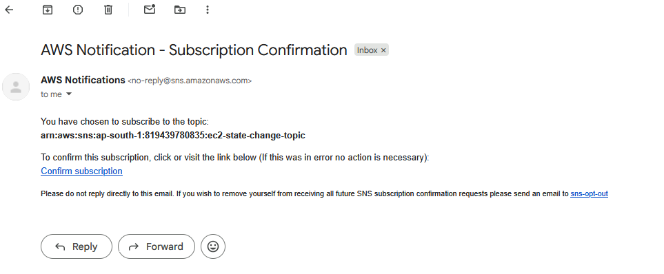
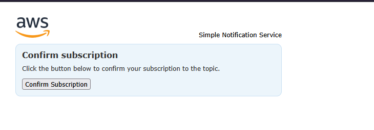
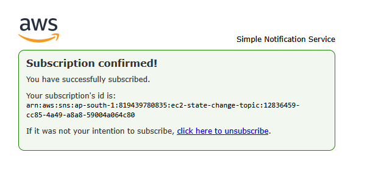
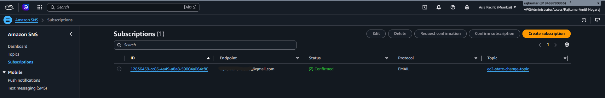

# Monitor EC2 Instance State Changes Using AWS Lambda, Boto3, EventBridge and SNS

## Overview

**Objective:** Automatically monitor changes in **EC2** instance states and send an email notification whenever an instance is started or stopped.

**What this project does:**

- Creates an **SNS** topic with an email subscription for notifications.
- Creates an **IAM** role that lets Lambda read **EC2** instance details and publish to **SNS**.
- Deploys a Python (Boto3) Lambda function that extracts the state-change details from the incoming event, looks up the instance's name and type, and publishes a formatted notification to **SNS**.
- Creates an Amazon EventBridge rule on the default event bus that triggers the Lambda function whenever an **EC2** instance enters the `running` or `stopped` state.
- Tests the whole pipeline by starting and stopping a real **EC2** instance and confirming that the emails arrive.

**Services used:** Amazon **EC2**, Amazon EventBridge, **AWS** Lambda, Amazon **SNS**, **AWS** **IAM**, Boto3 (**AWS** **SDK** for Python).

---

## Architecture



---

## Why EventBridge Is Used

**EC2** does not call Lambda directly when an instance changes state. Instead, **EC2** publishes an event (for example, *instance `i-**123**` is now `stopped`*) to the **default event bus** in that region. A Lambda function cannot listen for events on its own, because it only runs when something invokes it.

An **EventBridge rule** acts as the listener and router:

1. **Filter:** it checks every event on the bus against an event pattern and ignores events that do not match.
2. **Route:** when an event matches, it invokes the Lambda function and passes the event as input.

The alternative would be a Lambda that polls `describe_instances` every few minutes, compares states and works out what changed. That wastes invocations, delays notifications and needs somewhere to store the previous state. EventBridge delivers instant, event-driven notifications at essentially no cost.

---

## Prerequisites

- An **AWS** account with access to the **AWS** Management Console
- Basic familiarity with Python
- A valid email address that can receive mail
- **One **AWS** region used for everything** (this project used `Asia Pacific (Mumbai) ap-south-1`). EventBridge only receives **EC2** events from its own region, so the instance, rule, Lambda function and **SNS** topic must all be in the same region.

---

## Step 1: SNS Setup

### 1.1 Select the region



### 1.2 Create the topic

## Open **SNS** → **Topics** → **Create topic**.

2. **Type:** Standard
3. **Name:** `ec2-state-change-topic`
## Leave the other settings at their defaults and click **Create topic**.







Copy the topic **ARN** (`arn:aws:sns:<region>:<account-id>:ec2-state-change-topic`). It is needed in Step 3.

### 1.3 Subscribe an email address

## On the topic page, open the **Subscriptions** tab → **Create subscription**.

2. **Protocol:** Email
3. **Endpoint:** `<**YOUR**-**EMAIL**>`
## Click **Create subscription**.



### 1.4 Confirm the subscription

**SNS** sends a confirmation email. Open it (check spam if it is missing) and click **Confirm subscription**.







Refresh the **SNS** console and verify the subscription status is **Confirmed**.



---

## Step 2: IAM Role for Lambda

## Open **IAM** → **Roles** → **Create role**.

2. **Trusted entity type:** **AWS** service. **Use case:** Lambda. Click **Next**.
## Select both policies:
    - `AmazonEC2ReadOnlyAccess` (read instance details)
    - `AmazonSNSFullAccess` (publish notifications)
## Click **Next**, name the role `lambda-ec2-monitor-role`, and click **Create role**.

📸 ****ATTACH** **SCREENSHOT** 9:** The **Add permissions** page with both policies ticked


📸 ****ATTACH** **SCREENSHOT** 10:** The role **summary page** showing both policies attached


> **Note:** these managed policies are used for simplicity. See [Security Considerations](#security-considerations) for a least-privilege alternative.

---

## Step 3: Create the Lambda Function

### 3.1 Create the function

## Open **Lambda** → **Create function** → **Author from scratch**.

2. **Function name:** `ec2-state-change-notifier`
3. **Runtime:** Python 3.12
4. **Execution role:** Use an existing role → `lambda-ec2-monitor-role`
## Click **Create function**.

📸 ****ATTACH** **SCREENSHOT** 11:** The **Create function** form with the runtime and existing role visible


📸 ****ATTACH** **SCREENSHOT** 12:** The function **overview page** after creation


### 3.2 Add the code

Paste the following into `lambda_function.py` and click **Deploy**:

```python import os

import boto3 from botocore.exceptions import ClientError

# Initialize the Boto3 clients

sns = boto3.client(*sns*) ec2 = boto3.client(*ec2*)

TOPIC_ARN = os.environ[*SNS_TOPIC_ARN*]

def lambda_handler(event, context):
    print(f*Received event: {event}*)

    # 1. Extract details about the state change from the event
    detail = event.get(*detail*, {})
    instance_id = detail.get(*instance-id*, *unknown*)
    state = detail.get(*state*, *unknown*)
    region = event.get(*region*, *unknown*)
    event_time = event.get(*time*, *unknown*)

    # Look up extra details (the event itself has no name or type)
    name = *N/A*
    instance_type = *N/A*
    try:
    response = ec2.describe_instances(InstanceIds=[instance_id])
    instance = response[*Reservations*][0][*Instances*][0]
    instance_type = instance.get(*InstanceType*, *N/A*)
    for tag in instance.get(*Tags*, []):
    if tag[*Key*] == *Name*:
    name = tag[*Value*]
    except (ClientError, IndexError) as err:
    print(f*Could not describe {instance_id}: {err}*)

    # 2. Send an SNS notification with the details
    subject = f***EC2** instance {instance_id} is now {state}*
    message = (
    ***EC2** instance state change detected\n*
    *----------------------------------\n*
    f*Instance ID   : {instance_id}\n*
    f*Name          : {name}\n*
    f*Instance type : {instance_type}\n*
    f*New state     : {state}\n*
    f*Region        : {region}\n*
    f*Event time    : {event_time}\n*
    )

    response = sns.publish(TopicArn=TOPIC_ARN, Subject=subject, Message=message)
    print(f"Notification sent for {instance_id} ({state}). MessageId: {response['MessageId']}*)

    return {*instance_id*: instance_id, *state*: state, *message_id*: response[*MessageId"]}
```

📸 ****ATTACH** **SCREENSHOT** 13:** The code editor showing the **full script** and the ***Successfully updated the function*** banner


### 3.3 Code explanation

| Step | Requirement | Implementation |
|------|-------------|----------------|
| 1 | Extract details from the event | Reads `detail[*instance-id*]` and `detail[*state*]`, plus `region` and `time` from the event |
| 2 | Send an SNS notification with the instance and its new state | `sns.publish()` with a subject and a formatted message body |

**Design choices:**

- **Enriched details:** the EventBridge event contains only the instance ID and new state. The function calls `describe_instances` to add the instance's `Name` tag and type to the email, which is why the role needs **EC2** read access.
- **Resilient lookup:** if the lookup fails (for example, for a terminated instance), the error is caught and the notification is still sent with `N/A` values.
- **Configuration through environment variables:** the **SNS** topic **ARN** is not hard-coded.
- **Default values:** `event.get(...)` avoids a crash if a field is missing.

### 3.4 Configure the environment variable

Under **Configuration** → **Environment variables**, add:

| Key | Value |
|-----|-------|
| `SNS_TOPIC_ARN` | `<YOUR-TOPIC-ARN>` |

📸 ****ATTACH** **SCREENSHOT** 14:** The **Environment variables** page showing the saved value


### 3.5 Increase the timeout

Under **Configuration** → **General configuration**, set **Timeout** to **30 seconds**.

📸 ****ATTACH** **SCREENSHOT** 15:** The **General configuration** panel showing the new timeout


---

## Step 4: Manual Test of the Function (Optional)

Before connecting EventBridge, the function can be tested with a sample event to confirm that the Lambda and **SNS** parts work.

On the **Test** tab, create an event named `sample-stopped-event`:

```json
{
    *version*: *0*,
    *id*: *test-event-id*,
    *detail-type*: ***EC2** Instance State-change Notification*,
    *source*: *aws.ec2*,
    *account*: *123456789012*,
    *time*: ***2026**-10-**14T12**:00:**00Z***,
    *region*: *ap-south-1*,
    *resources*: ["arn:aws:ec2:ap-south-1:**123456789012**:instance/i-0123456789abcdef0*],
    *detail*: {
    *instance-id*: *i-0123456789abcdef0*,
    *state*: *stopped"
    }
}
```

Click **Test**. The instance ID is fictional, so the lookup for its name and type fails harmlessly and the email shows `N/A` for those fields.

📸 ****ATTACH** **SCREENSHOT** 16:** The **test event configuration**


📸 ****ATTACH** **SCREENSHOT** 17:** The **execution result** showing **Succeeded**


📸 ****ATTACH** **SCREENSHOT** 18:** The **email** received from the manual test


---

## Step 5: EventBridge Rule

In the current **AWS** console, Amazon EventBridge has been reorganised: the landing page offers **Create event bus**, and the old **Rules** menu item is no longer shown separately. This is not the option to use here. **EC2** sends its state-change events to the **default** event bus, which already exists in every region, so the rule is created from the **Event buses** page on that bus.

### 5.1 Open the default event bus

## Open **Amazon EventBridge** and click **Event buses** in the left menu.

## Click the **default** event bus. ## Choose **Create rule**.

📸 ****ATTACH** **SCREENSHOT** 19:** The **Event buses** page showing the **default** bus


### 5.2 Define the rule

| Setting | Value |
|---------|-------|
| **Name** | `ec2-state-change-rule` |
| **Event bus** | default |
| **Rule type** | Rule with an event pattern |

Click **Next**.

📸 ****ATTACH** **SCREENSHOT** 20:** The **rule details** form filled in


### 5.3 Build the event pattern

Set the **Event source** to ****AWS** events or EventBridge partner events**, choose **Custom pattern (**JSON** editor)** and enter:

```json
{
    *source*: [*aws.ec2*],
    *detail-type*: [***EC2** Instance State-change Notification*],
    *detail*: {
    *state*: [*running*, *stopped*]
    }
}
```

| Field | Meaning |
|-------|---------|
| `source` | Only events published by EC2 |
| `detail-type` | Only instance state-change notifications |
| `detail.state` | Only the `running` (started) and `stopped` states, which gives one email per start or stop instead of also sending emails for `pending` and `stopping` |

Click **Next**.

📸 ****ATTACH** **SCREENSHOT** 21:** The **event pattern** **JSON**


### 5.4 Select the Lambda target

| Setting | Value |
|---------|-------|
| **Target types** | AWS service |
| **Select a target** | Lambda function |
| **Target location** | Target in this account |
| **Function** | `ec2-state-change-notifier` |
| **Execution role** | Create default role (EventBridge creates a role named `Amazon_EventBridge_Invoke_Lambda_...`, which gives the rule permission to invoke the function) |

Click **Next**, skip the optional tags (**Next**), review the settings, and click **Create rule**.

📸 ****ATTACH** **SCREENSHOT** 22:** The **target configuration** with the Lambda function selected


📸 ****ATTACH** **SCREENSHOT** 23:** The **rule detail page** showing the status **Enabled**, the event pattern and the Lambda target


### 5.5 Add the trigger on the Lambda side

Because the rule invokes the function through an execution role, the Lambda console did not list the rule under **Triggers** (it showed 0 triggers). The trigger was therefore added from the function so that it also appears in the Lambda overview:

## Open the function `ec2-state-change-notifier` → **Add trigger**.

2. **Select a source:** EventBridge (CloudWatch Events)
3. **Rule:** Existing rules → `ec2-state-change-rule`
## Click **Add**.

📸 ****ATTACH** **SCREENSHOT** 24:** The **Add trigger** form filled in


📸 ****ATTACH** **SCREENSHOT** 25:** The function **overview** showing EventBridge connected as a trigger


---

## Step 6: Create an EC2 Instance

The instance must be in the same region as the rule.

## Open **EC2** → **Instances** → **Launch instances**.

2. **Name:** `monitor-demo-instance`
3. ****AMI**:** Amazon Linux **2023**
4. **Instance type:** `t3.micro` (free-tier eligible)
5. **Key pair:** Proceed without a key pair (the instance is never logged in to)
## Leave the network and storage settings at their defaults and click **Launch instance**.

📸 ****ATTACH** **SCREENSHOT** 26:** The **launch form** showing the name, **AMI** and instance type


Because the rule is already active, launching the instance produces a `running` event and an email.

📸 ****ATTACH** **SCREENSHOT** 27:** The **Instances** list showing the instance in the **Running** state


📸 ****ATTACH** **SCREENSHOT** 28:** The ***is now running* email** received after launch


---

## Step 7: End-to-End Testing

### 7.1 Stop the instance

Select the instance → **Instance state** → **Stop instance** → **Stop**. Wait for the state to become **Stopped**.

📸 ****ATTACH** **SCREENSHOT** 29:** The **Instances** list showing the instance **Stopped**


📸 ****ATTACH** **SCREENSHOT** 30:** The ***is now stopped* email**, with the full body visible


### 7.2 Start the instance

Select the instance → **Instance state** → **Start instance**. Wait for **Running**.

📸 ****ATTACH** **SCREENSHOT** 31:** The **Instances** list showing the instance **Running** again


📸 ****ATTACH** **SCREENSHOT** 32:** The second ***is now running* email**


### 7.3 Sample notification

Each email follows this format:

``` Subject: **EC2** instance i-0abc123def4567890 is now stopped

## EC2 instance state change detected

Instance ID   : i-0abc123def4567890 Name          : monitor-demo-instance Instance type : t3.micro New state     : stopped Region        : ap-south-1 Event time    : **2026**-10-**21T02**:30:**00Z** ```

### 7.4 Results

| Action | Event matched | Email received |
|--------|---------------|----------------|
| Launch instance | `running` | Yes |
| Stop instance | `stopped` | Yes |
| Start instance | `running` | Yes |

The `pending` and `stopping` transitions do not trigger emails because the rule filters them out.

---

## Security Considerations

The managed policies `AmazonEC2ReadOnlyAccess` and `AmazonSNSFullAccess` grant more access than this function needs. For a real deployment, replace them with a least-privilege policy scoped to the one topic:

```json
{
    *Version*: ***2012**-10-17*,
    *Statement*: [
    {
    *Effect*: *Allow*,
    *Action*: *ec2:DescribeInstances*,
    *Resource*: ***
    },
    {
    *Effect*: *Allow*,
    *Action*: *sns:Publish*,
    *Resource*: "arn:aws:sns:<**YOUR**-**REGION**>:<**ACCOUNT**-ID>:ec2-state-change-topic"
    }
    ]
}
```

Other recommendations:

- Keep the event pattern as narrow as possible so the function is invoked only when needed.
- Use an **SNS** topic access policy to limit who can publish to or subscribe to the topic.
- Terminate test instances when finished.

---

## Troubleshooting

| Problem | Likely cause | Fix |
|---------|--------------|-----|
| No confirmation email | Email in spam, or typo in the address | Check spam, or resend the confirmation from the SNS console |
| Subscription stays *Pending confirmation* | The confirmation link was not clicked | Open the email and click **Confirm subscription** |
| Only the *Create event bus* option is visible | Wrong EventBridge page | Go to **Event buses** → **default** and create the rule there |
| Lambda shows 0 triggers after creating the rule | The rule invokes the function through an execution role, so Lambda does not list it | Add the trigger from the function (Step 5.5) |
| Manual test works but real stop/start sends nothing | Rule is in a different region, disabled, or has a pattern typo | Check the region, rule status (**Enabled**) and pattern |
| `AuthorizationError` on `sns.publish` | Role is missing SNS permissions, or the topic is in another region | Check the role policies and `SNS_TOPIC_ARN` |
| `KeyError: 'SNS_TOPIC_ARN'` | Environment variable missing or misspelled | Add it under **Configuration** → **Environment variables** |
| Name and type show as `N/A` in a real email | Role is missing EC2 read access, or the instance has no `Name` tag | Attach `AmazonEC2ReadOnlyAccess` and tag the instance |
| No email when the instance is terminated | Expected | The rule matches only `running` and `stopped` |

---

## Cleanup

Remove resources in this order to avoid charges:

1. **Terminate the **EC2** instance.**
2. **Delete the EventBridge rule** `ec2-state-change-rule`.
3. **Delete the Lambda function** `ec2-state-change-notifier`.
4. **Delete the **SNS** subscription and topic.**
5. **Delete the **IAM** roles** `lambda-ec2-monitor-role` and the auto-created `Amazon_EventBridge_Invoke_Lambda_...` role.

📸 ****ATTACH** **SCREENSHOT** 33 (optional):** Confirmation of deletion or the empty lists


---

## Conclusion

This project built an event-driven monitoring pipeline for **EC2**. **EC2** publishes state-change events to the default event bus, an EventBridge rule filters for started and stopped instances and triggers a Boto3-based Lambda function, and the function publishes a detailed notification to **SNS**, which delivers it by email. Testing with a real instance confirmed that an email arrives for each start and stop.

**Possible extensions:**

- Match additional states such as `terminated` or `pending`.
- Send notifications to Slack, **SMS** or a mobile push endpoint through additional **SNS** subscriptions.
- Filter by instance tag so only selected instances trigger notifications.
- Monitor multiple regions by creating the same rule in each region.
- Replace the managed policies with the least-privilege policy above.

---

## Repository Structure

```
.
├── **README**.md
├── lambda_function.py
└── screenshots/
    ├── architecture.png
    ├── 01-console-region.png
    ├── 02-create-topic-form.png
    ├── ...
    └── 33-cleanup.png
```
